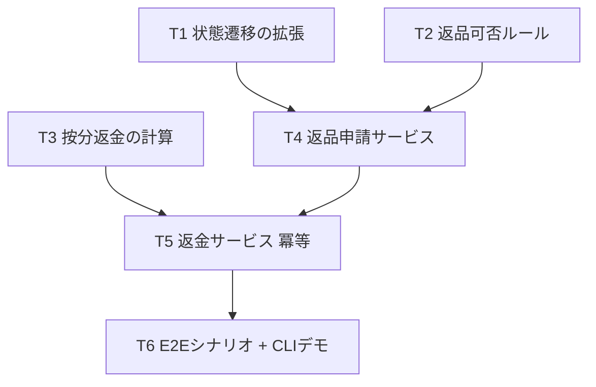

# タスク分解の例: 「返品機能の追加」

> 「返品機能を追加して」を1回で丸投げせず、エージェント1回分のチケットに分解した例です。
> (このリポジトリには完成形が入っています。ワークショップでは「もし未実装だったら」という想定で使います)

## 依存関係 (DAG)



- **並列実行可 (git worktree):** T1 / T2 / T3 は互いに独立。別々の worktree で同時に進められる
  ```bash
  git worktree add ../ec-demo-T1 -b feat/T1 main
  git worktree add ../ec-demo-T2 -b feat/T2 main
  git worktree add ../ec-demo-T3 -b feat/T3 main
  ```
- T4 は T1・T2 のマージ後、T5 は T3・T4 の後、T6 は最後 (直列)

---

## T1: 状態遷移の拡張 (受取済 → 返品申請 → 返金済)
- **目的:** BR-02 / BR-11 の遷移を追加。返金済 → 返品申請 (2回目の部分返品) も許可
- **変更してよいファイル:** `src/orders/order-status.js`, `test/orders.test.js`
- **受け入れ条件:**
  - `node --test test/orders.test.js`
  - `npm test && npm run lint`
  - `test -z "$(git diff --name-only main -- . ':!src/orders/order-status.js' ':!test/orders.test.js')"`
- **依存:** なし ／ **並列:** 可

## T2: 返品可否ルール (期限・状態・商品状態)
- **目的:** BR-09 (8日以内), BR-10 (開封・使用済は不可、不良品は可) の判定関数
- **変更してよいファイル:** `src/returns/return-service.js` (判定関数のみ), `test/returns.test.js`
- **受け入れ条件:**
  - `node --test test/returns.test.js` (8日ちょうど=可、8日12時間=不可 のテストを含む)
  - `npm test && npm run lint`
- **未決定:** TBD-01 (タイムゾーン境界) → **推測で実装せず PO に質問**。暫定は経過時間判定
- **依存:** なし ／ **並列:** 可

## T3: 按分返金の計算 (純粋関数)
- **目的:** BR-12 の式どおりに返金額を計算 (`calcRefundAmount`)
- **変更してよいファイル:** `src/returns/refund-calc.js`, `test/refunds.test.js`
- **変更禁止:** `test/golden/refunds.json` (人間承認済みの期待値)
- **受け入れ条件:**
  - `node --test test/golden.test.js` (R-01〜R-06 が全て pass)
  - `npm test && npm run lint`
- **未決定:** TBD-02 (分割返品の端数調整) → 質問。勝手に「最後で調整」を実装しない
- **依存:** なし ／ **並列:** 可

## T4: 返品申請サービス
- **目的:** `requestReturn(order, items)`。T2 の判定を使い、部分返品・数量上限 (BR-11) を扱う
- **変更してよいファイル:** `src/returns/return-service.js`, `test/returns.test.js`, `test/helpers.js`
- **受け入れ条件:**
  - `node --test test/returns.test.js`
  - `npm test && npm run lint`
- **依存:** T1, T2 ／ **並列:** 不可

## T5: 返金サービス (冪等)
- **目的:** BR-13 (二重返金しない), BR-14 (支払額を超えない・失敗時は状態不変)
- **変更してよいファイル:** `src/returns/refund-service.js`, `test/refunds.test.js`
- **変更禁止:** `src/payment/` (決済アダプタは読むだけ。hook でブロックされる)
- **受け入れ条件:**
  - `node --test test/refunds.test.js` (同じ返品を**時刻を変えて**2回返金しても gateway の返金は1件)
  - `npm test && npm run lint`
- **依存:** T3, T4 ／ **並列:** 不可

## T6: E2E シナリオ + CLI デモ
- **目的:** 注文 → 決済 → 発送 → 受取 → 部分返品 → 返金 の通しシナリオ
- **変更してよいファイル:** `src/cli.js`, `test/e2e.test.js` (新規)
- **受け入れ条件:**
  - `npm run demo` がエラーなく終了し、ステータス履歴が `… → 返品申請 → 返金済` で終わる
  - `npm test && npm run lint`
- **依存:** T5 ／ **並列:** 不可
